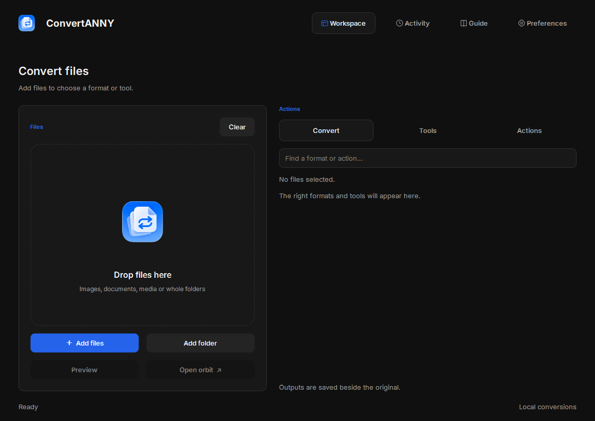
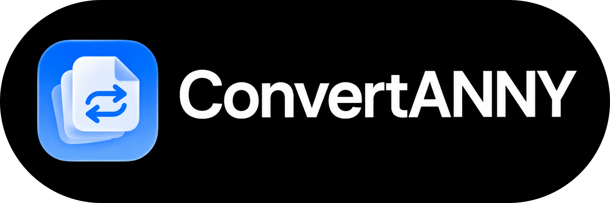

# ConvertANNY

File conversion for Windows. Created by **Ace App Co**.

<p align="center">
  
</p>

<p align="center">
  <a href="#overview">Overview</a> ·
  <a href="#features">Features</a> ·
  <a href="#using-convertanny">Using ConvertANNY</a> ·
  <a href="#build">Build</a> ·
  <a href="#license">License</a>
</p>

## Overview

Convert files from a desktop workspace or directly from File Explorer. The orbit brings conversion formats, tools and file actions to the file you're working with.

Files stay on your PC unless you choose an online feature.



## Features

| Area | Included |
| --- | --- |
| Conversion | Images, PDFs, text, Office documents, spreadsheets, presentations, audio, video, subtitles, archives, e-books, comics and fonts |
| Images | Crop, resize, compress, rotate, straighten scans, watermark, extract text, remove backgrounds and blur faces |
| PDFs | Merge, split, arrange, rotate, extract pages, add page numbers, watermark, sign and password-protect |
| Audio and video | Trim, compress, merge, normalize audio, create GIFs and ringtones, work with subtitles and transcribe speech |
| Files | Batch rename, copy, move, calculate checksums, split and join large files, and create encrypted archives |
| Orbit and Explorer | Context-sensitive operations, keyboard shortcuts, drag gestures, file preview and optional right-click integration |
| Automation | Watched folders, saved image/video presets, operation chains and custom application actions |
| Floating player | Images, documents, music, video and supported links, with playback controls and pinned windows |
| Phone sharing | Same-network QR transfers, folder ZIP downloads, PC-hosted internet links, temporary uploads, cloud links, Quick Share and Bluetooth where available |
| Jobs and outputs | Activity history, progress, cancellation, queued or parallel jobs, and configurable output destinations |
| Preferences | Light/dark appearance, interface language, sounds, animations, startup behavior and settings import/export |
| Command line | List available operations, convert files and run unattended tools |

[Browse the complete feature guide →](docs/FEATURES.md) · [Phone sharing →](docs/FEATURES.md#sharing)

Office document conversion requires Microsoft Office or LibreOffice. RAR creation requires WinRAR. Online sharing and link playback require an internet connection.

## Using ConvertANNY

1. Add files to the workspace, or drag a file in File Explorer.
2. While dragging, press **Shift** for conversions, **Ctrl** for tools or **Alt** for file actions.
3. Choose an orbit segment to run the operation. Follow progress in Activity.

You can also right-click a file and choose **ConvertANNY** when Explorer integration is enabled.

## Install

Download **ConvertANNY-Setup-0.1.0.exe** from the [GitHub releases page](https://github.com/p4yy/ConvertANNY/releases/latest). The installer lets you choose whether to add an Explorer menu entry and a Desktop shortcut.

The release includes SHA-256 checksums and matching application source. Windows may show an unknown-publisher prompt because this release is not code-signed.

## Build

Requires Windows and Python 3.12.

```powershell
py -3.12 -m venv .venv
.\.venv\Scripts\python.exe -m pip install -r requirements-build.txt
.\scripts\build.ps1
.\.venv\Scripts\python.exe scripts/package.py
```

The application bundle and setup EXE are written to `dist/`. Installer compilation uses the .NET Framework C# compiler included with Windows.

Optional models and online helpers download when their features need them. Build output, downloaded model caches and local Python environments are excluded from version control.

## License

Created by **Ace App Co**. Copyright 2026 Ace App Co.

Licensed under the [GNU Affero General Public License v3.0 only](LICENSE).
Redistributed modifications must preserve notices, identify changes, and provide corresponding source as required by the license. Commercial use and redistribution are permitted.

See [copyright and branding](COPYRIGHT.md) and [third-party components](THIRD_PARTY.md). Third-party components keep their own licenses. Earlier Apache-2.0 grants remain valid for the copies they cover.


---

<p align="center">
  
</p>

<p align="center"><sub>Created by Ace App Co</sub></p>
