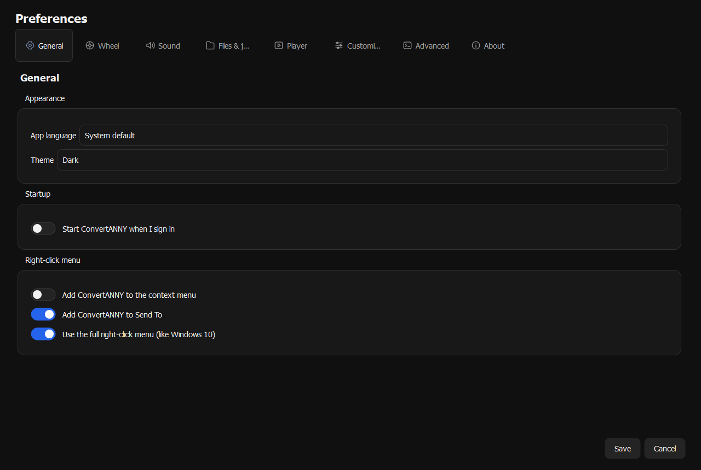
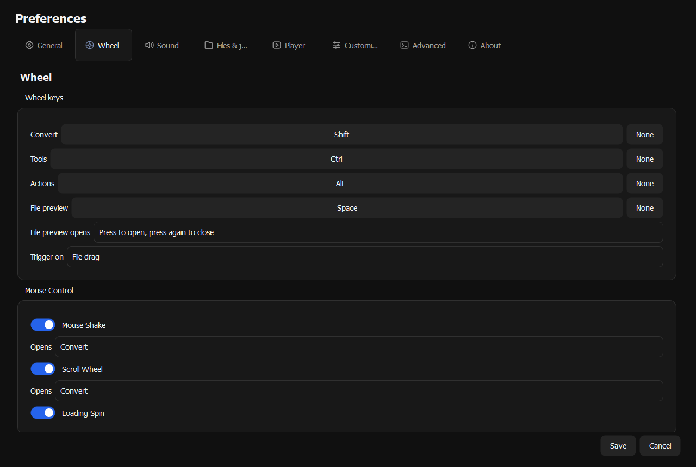
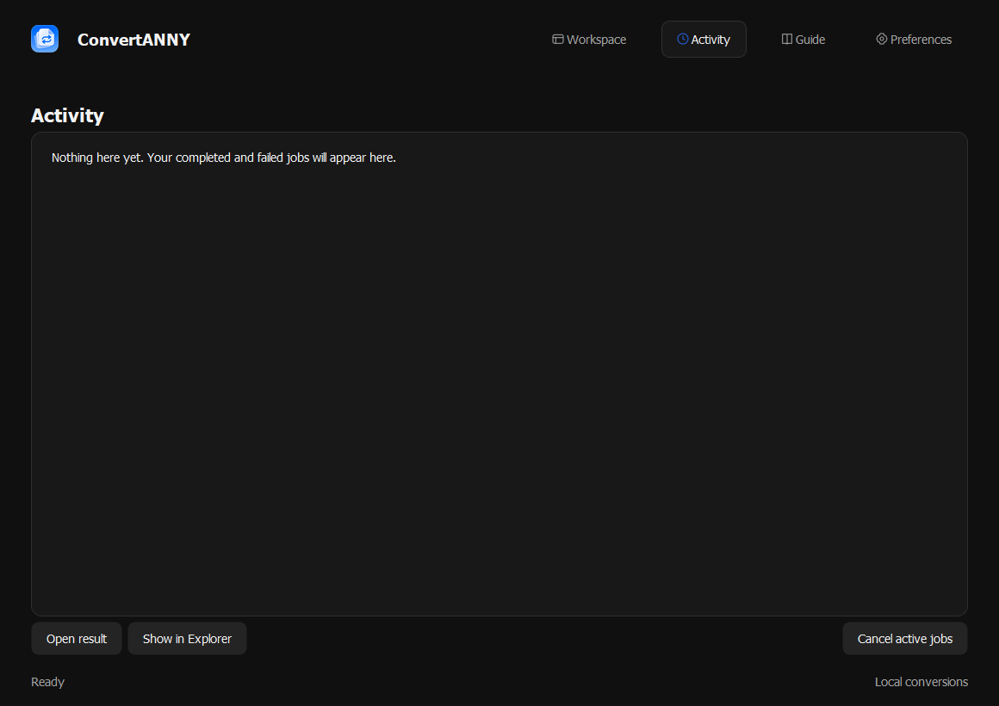

# ConvertANNY

File conversion for Windows.

<p align="center">
  <a href="https://github.com/p4yy/ConvertANNY">Repository</a> ·
  <a href="https://github.com/p4yy/ConvertANNY/releases/latest">Download</a> ·
  <a href="docs/GETTING-STARTED.md">Getting started</a> ·
  <a href="docs/FEATURES.md">Features</a> ·
  <a href="CHANGELOG.md">Release notes</a> ·
  <a href="docs/RELEASING.md">Releases</a> ·
  <a href="SECURITY.md">Security</a> ·
  <a href="https://github.com/p4yy/ConvertANNY/actions">Development</a>
</p>

<p align="center">
  
</p>

<p align="center">
  <a href="https://github.com/p4yy/ConvertANNY/releases/latest"></a>
  <a href="https://github.com/p4yy/ConvertANNY/actions/workflows/release.yml"></a>
  <a href="LICENSE"></a>
</p>

<p align="center">
  <a href="https://ko-fi.com/acevisualsco"></a>
  <a href="https://www.paypal.com/paypalme/aceevisuals"></a>
</p>

## Overview

| File Explorer | File support | Privacy |
| --- | --- | --- |
| Add files in the workspace or open ConvertANNY from File Explorer. | Convert images, documents, PDFs, audio, video, archives and more. | Files stay on your PC unless you choose an online feature. |

[Install and setup](docs/GETTING-STARTED.md) · [Privacy](docs/PRIVACY.md) · [Release notes](CHANGELOG.md) · [Contributing](CONTRIBUTING.md) · [Security](SECURITY.md)

| Workspace | Preferences |
| --- | --- |
|  |  |
| **File workspace** — Select files and choose a conversion or action. | **General preferences** — Set the language, theme, startup and right-click options. |

| Wheel controls | Activity |
| --- | --- |
|  |  |
| **Wheel controls** — Set keyboard shortcuts and mouse gestures. | **Activity** — Review completed and failed jobs. |

## Features

| Area | Included |
| --- | --- |
| Conversion | Images, PDFs, text, Office documents, spreadsheets, presentations, audio, video, subtitles, archives, e-books, comics and fonts |
| Images | Crop, resize, compress, rotate, straighten scans, watermark, extract text, remove backgrounds and blur faces |
| PDFs | Merge, split, arrange, rotate, extract pages, add page numbers, watermark, sign and password-protect |
| Audio and video | Trim, compress, merge, normalize audio, create GIFs and ringtones, work with subtitles and transcribe speech |
| Files | Batch rename, copy, move, calculate checksums, split and join large files, and create encrypted archives |
| Orbit and Explorer | Context-sensitive operations, keyboard shortcuts, drag gestures, file preview and optional right-click integration |
| Automation | Watched folders, saved image/video presets, operation chains and custom application actions |
| Floating player | Images, documents, music, video and supported links, with playback controls and pinned windows |
| Phone sharing | Same-network QR transfers, folder ZIP downloads, PC-hosted internet links, temporary uploads, cloud links, Quick Share and Bluetooth where available |
| Jobs and outputs | Activity history, progress, cancellation, queued or parallel jobs, and configurable output destinations |
| Preferences | Light/dark appearance, interface language, sounds, animations, startup behavior and settings import/export |
| Command line | List available operations, convert files and run unattended tools |

[Feature guide](docs/FEATURES.md) · [Phone sharing](docs/FEATURES.md#sharing)

Office document conversion requires Microsoft Office or LibreOffice. RAR creation requires WinRAR. Online sharing and link playback require an internet connection.

## Using ConvertANNY

1. Add files to the workspace, or drag a file in File Explorer.
2. While dragging, press **Shift** for conversions, **Ctrl** for tools or **Alt** for file actions.
3. Choose an orbit segment to run the operation. Follow progress in Activity.

You can also right-click a file and choose **ConvertANNY** when Explorer integration is enabled.

## Install

Download the latest `ConvertANNY-Setup` installer from the [GitHub releases page](https://github.com/p4yy/ConvertANNY/releases/latest). The installer lets you choose whether to add an Explorer menu entry and a Desktop shortcut. See [Getting started](docs/GETTING-STARTED.md) for setup details.

## Build

Requires Windows and Python 3.12.

```powershell
py -3.12 -m venv .venv
.\.venv\Scripts\python.exe -m pip install -r requirements-build.txt
.\scripts\build.ps1
.\.venv\Scripts\python.exe scripts/package.py
```

The application bundle and setup EXE are written to `dist/`. Installer compilation uses the .NET Framework C# compiler included with Windows.

Optional models and online helpers download when their features need them. Build output, downloaded model caches and local Python environments are excluded from version control.

## Privacy

File conversions run on your PC. Online sharing, link playback and optional crash reports can contact external services when you choose or enable those features. See the [privacy notes](docs/PRIVACY.md).

## License

Copyright 2026 Ace App Co.

Licensed under the [GNU Affero General Public License v3.0 only](LICENSE).
Redistributed modifications must preserve notices, identify changes, and provide corresponding source as required by the license. Commercial use and redistribution are permitted.

See [copyright and branding](COPYRIGHT.md) and [third-party components](THIRD_PARTY.md). Third-party components keep their own licenses. Earlier Apache-2.0 grants remain valid for the copies they cover.

---

<p align="center">
  
</p>
